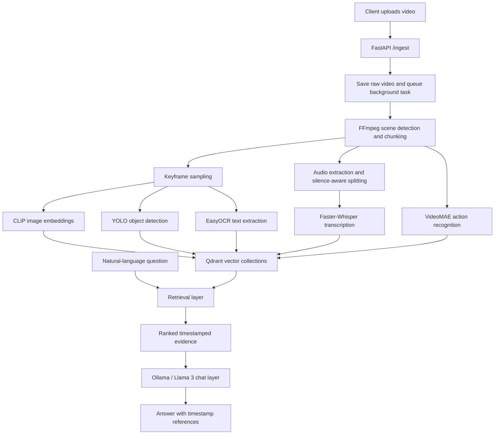

# Multimodal Video Search & Agentic Retrieval Engine

An experimental video-understanding backend that turns uploaded videos into searchable, timestamped multimodal evidence. Instead of searching only subtitles or filenames, it indexes visual frames, detected objects, on-screen text, spoken words, and scene-level action labels, then retrieves relevant moments for natural-language questions.

> **Project status:** This README describes the code currently present on the `main` branch. The repository is an evolving prototype. In particular, the chat integration, dependency manifest, and Docker setup have gaps documented below; the README does not imply that every advertised path is production-ready.

## Contents

- [What it does](#what-it-does)
- [Architecture](#architecture)
- [How the pipeline works](#how-the-pipeline-works)
- [Retrieval and ranking](#retrieval-and-ranking)
- [Conversational layer](#conversational-layer)
- [Repository tour](#repository-tour)
- [Technology stack](#technology-stack)
- [Requirements and setup](#requirements-and-setup)
- [Running the API](#running-the-api)
- [API reference](#api-reference)
- [Storage layout](#storage-layout)
- [Current implementation notes](#current-implementation-notes)
- [Potential next steps](#potential-next-steps)

## What it does

The system is designed to answer questions such as:

- "When does a person enter the room?"
- "Find the part where a car appears."
- "What does the slide say?"
- "Where is the speaker discussing the database?"
- "What action is happening around the middle of the video?"

The intended workflow is:

1. Upload a video through the FastAPI endpoint.
2. Split the video into scenes and representative frames.
3. Extract and transcribe its audio.
4. Analyze frames for visual content and text.
5. Convert the extracted information into dense and sparse vectors.
6. Store the vectors and metadata in Qdrant, keyed by a video ID.
7. Search the indexed evidence and use a local LLM to formulate a timestamp-grounded answer.

The project combines several complementary signals:

| Signal | What is extracted | Main implementation |
|---|---|---|
| Visual appearance | CLIP image embeddings for sampled frames | `core/embedder.py` |
| Objects | Object labels, confidence values, and bounding boxes | `core/detector.py` |
| On-screen text | Text detected in frames | `core/ocr.py` |
| Spoken content | Speech transcripts and text embeddings | `core/audio_processor.py` |
| Scene/action semantics | Video-level action labels | `core/scene.py` |

## Architecture



### Main components

- **FastAPI (`main.py`)** exposes video ingestion and video-chat endpoints and initializes the models during application startup.
- **Video processing (`core/ingestion.py` and the ingestion worker in `main.py`)** creates per-video workspaces, finds scene boundaries, extracts frames, and prepares audio.
- **Multimodal encoders** represent images and text as vectors. CLIP is used for visual similarity; Sentence Transformers is used for transcript/OCR/action text; FastEmbed's Qdrant BM25 model produces sparse lexical vectors.
- **Qdrant (`core/vector_db.py`)** stores vectors with payload metadata such as video ID, timestamp, frame/chunk name, and extracted text.
- **Retrieval (`core/retriever.py`)** searches the visual, transcript, OCR, and scene-semantics collections and fuses ranked results.
- **Local LLM (`core/chat_engine.py`, Ollama)** is intended to turn retrieved evidence into a conversational answer.

## How the pipeline works

### 1. Upload and job creation

`POST /ingest` accepts an MP4, AVI, MOV, or MKV file. The API creates a UUID for the video, saves the original file under `storage/raw/`, and schedules `run_background_ingestion` as a FastAPI background task. The response contains the `video_id` that identifies the indexed video.

### 2. Workspace and audio preparation

The ingestion pipeline creates a workspace under `storage/processed/<video_id>/` with folders for chunks, frames, and audio. FFmpeg extracts a 16 kHz, mono WAV audio track. Scene boundaries are detected with FFmpeg's `scdet` filter and metadata timestamps; very short intervals are merged before scene clips are written.

The worker also applies a silence-aware post-processing step to long scene clips. It tries to split clips at detected pauses, with a 45-second maximum target chunk length and fixed-window fallback when no suitable pause is found.

### 3. Frame sampling and visual analysis

For each scene, the pipeline samples timestamps at an interval derived from the scene duration (bounded between 0.5 and 2 seconds). It runs YOLOv10 on sampled frames and saves the first frame plus frames where the detected object set changes. The saved keyframes are then processed by the ingestion worker:

- **YOLOv10** records object names, confidence scores, and bounding boxes.
- **EasyOCR** reads visible text. Non-empty OCR results receive a 384-dimensional Sentence Transformer embedding and a BM25 sparse vector.
- **CLIP ViT-B/32** creates a normalized 512-dimensional image embedding. The detected object labels are also represented with a BM25 sparse vector.

Each record includes the video ID and a timestamp derived from the frame filename. Visual frame records go to `video_frames`; explicit OCR records go to `video_ocr`.

### 4. Speech transcription and scene semantics

Each scene chunk is converted to 16 kHz mono WAV and passed to Faster-Whisper (the `base` model in the current application startup configuration). The transcript is embedded with `all-MiniLM-L6-v2` (384 dimensions) and with the Qdrant BM25 sparse model. The resulting records are stored in `video_transcripts`, with chunk start/end times and transcript text in the payload.

The same video chunk is passed to VideoMAE, which samples 16 frames uniformly and predicts its top five Kinetics action labels. Those labels are joined into text, embedded, and stored in `video_scene_semantics`.

A JSON transcript cache is also written to `storage/processed/<video_id>/transcripts/transcript.json`.

### 5. Vector storage

Qdrant is configured with four collections:

| Collection | Dense vector | Sparse vector | Payload purpose |
|---|---:|---|---|
| `video_frames` | `clip`: 512 dimensions | `bm25` | Frame timestamp, detected objects, OCR text, raw detections |
| `video_transcripts` | `dense`: 384 dimensions | `bm25` | Transcript text and chunk time range |
| `video_ocr` | `dense`: 384 dimensions | `bm25` | Recognized on-screen text and frame timestamp |
| `video_scene_semantics` | `dense`: 384 dimensions | `bm25` | Action labels and chunk time range |

The Qdrant manager creates a collection when it cannot find it and provides methods to upsert each record type.

## Retrieval and ranking

A natural-language query is encoded in three ways:

1. **CLIP text embedding** (512 dimensions) for matching visual frames.
2. **Sentence Transformer embedding** (384 dimensions) for matching transcript, OCR, and action text.
3. **BM25 sparse embedding** for lexical matching of words and phrases.

The retriever searches each applicable collection using dense and sparse vectors, with a `video_id` filter so results belong to the requested video. It first fuses the dense and sparse rankings within each channel, then combines the channel rankings.

The fusion method is **Reciprocal Rank Fusion (RRF)**. For a result at rank `r`, a channel contributes approximately:

`weight / (k + r)`

where `k` defaults to 60. This lets rankings from different embedding spaces be combined without assuming their raw similarity scores are directly comparable. The current final channel weights favor scene/action semantics (1.4) and visual frames (1.2), with transcript and OCR channels at 1.0.

The retriever also provides `get_temporal_context()`, which scrolls the four collections for indexed evidence inside a time window around a selected timestamp, deduplicates it, and returns it in chronological order.

## Conversational layer

There are two agent/chat implementations in the repository:

- **`core/chat_engine.py` — currently wired into the API.** It gathers retrieval context, builds a system prompt that asks Llama 3 to answer only from that evidence, includes chat history, and extracts timestamp markers from the answer to maintain an active moment in an in-memory session.
- **`core/lang.py` — LangGraph-based implementation.** It defines a richer state machine for classifying user intent (new search, follow-up, temporal follow-up, clarification, summary, or out-of-scope), retrieving hits, deciding whether to select a result or ask the user to choose, and maintaining conversational state. **It is not imported by `main.py` in the current branch**, so its graph is not the chat flow currently exposed by the API.
- **`core/agent.py` — query planning helper.** It asks a local Ollama Llama 3 model to turn a raw request into an optimized query, target channels, and an optional time filter, with a fallback plan if the LLM is unavailable. It is initialized by `main.py`, but the current `core/chat_engine.py` implementation does not call its planning method.

The active chat sessions are stored in the Python process memory in `main.py`. They are not durable across server restarts and are not shared across multiple API workers.

## Repository tour

Every tracked source/configuration file in the current repository is described below.

| Path | Responsibility |
|---|---|
| `main.py` | FastAPI application, model initialization/lifespan, request schemas, upload endpoint, background ingestion worker, silence-aware chunk splitting, multimodal indexing, chat endpoint, and session cleanup endpoint. This is the main application entry point. |
| `core/__init__.py` | Package marker for the `core` Python package. Currently empty. |
| `core/agent.py` | Defines the Pydantic `QueryPlan` and `AgenticQueryEngine`; calls Ollama to structure a natural-language search request and falls back to a default plan. |
| `core/audio_processor.py` | Initializes Faster-Whisper and `all-MiniLM-L6-v2`; extracts chunk audio with FFmpeg; transcribes speech and creates dense text embeddings. |
| `core/chat_engine.py` | Active chat engine imported by `main.py`; retrieves context, assembles prompts/history, calls Ollama, and updates the active timestamp in session state. |
| `core/detector.py` | Loads YOLOv10 weights (downloads them if absent), selects CUDA/CPU, and returns detected object labels, confidence values, and bounding boxes for an image. |
| `core/embedder.py` | Loads CLIP ViT-B/32 and its processor; converts an image frame into a normalized 512-dimensional embedding. |
| `core/ingestion.py` | Manages raw/processed storage directories; extracts audio and frames; detects scene changes; slices scene clips; samples frames and saves keyframes when object detections change. |
| `core/lang.py` | Separate LangGraph-based conversational workflow with intent classification, retrieval, confidence handling, clarification options, temporal context, and response generation. Not currently connected to the API entry point. |
| `core/ocr.py` | Wraps EasyOCR and returns recognized text from an image. |
| `core/retriever.py` | Creates query embeddings, searches Qdrant dense and sparse vectors across all four collections, applies RRF ranking fusion, and fetches timestamp-local context. |
| `core/scene.py` | Loads VideoMAE, decodes video chunks with PyAV, samples 16 frames, and predicts top-k action labels. |
| `core/vector_db.py` | Connects to Qdrant, creates the four vector collections with their named dense/sparse vector configurations, and upserts indexed points. |
| `config/config.py` | Empty placeholder; no settings are currently defined or loaded from this module. |
| `requirements.txt` | Current pinned Python dependency list. It does not yet include every package imported by the application; see [Current implementation notes](#current-implementation-notes). |
| `docker-compose.yml` | Defines an API container and a Qdrant container, ports, storage mounts, and a named Qdrant volume. Its API build depends on a Dockerfile that is currently empty/mis-cased (see notes). |
| `DockerFile` | Empty file. It currently does not provide a usable container build definition. |
| `.gitignore` | Currently ignores only `storage/`. |
| `yolov10n.pt` | YOLOv10n model weights checked into the repository; the detector can also download weights if the expected file is missing. |
| `__pycache__/`, `core/__pycache__/` | Checked-in Python bytecode caches. These are generated artifacts, not application source, and normally should not be committed. |

## Technology stack

| Technology | Role |
|---|---|
| Python | Application and pipeline implementation |
| FastAPI, Uvicorn, Pydantic | HTTP API, ASGI server, and request validation |
| FFmpeg / FFprobe | Audio extraction, frame extraction, scene detection, and video slicing |
| Qdrant | Vector database and metadata storage |
| CLIP (OpenAI `clip-vit-base-patch32`) | Image and text-in-CLIP-space embeddings |
| Sentence Transformers (`all-MiniLM-L6-v2`) | Dense embeddings for transcript, OCR, and action text |
| FastEmbed (`Qdrant/bm25`) | Sparse lexical retrieval vectors |
| Faster-Whisper | Speech-to-text transcription |
| Ultralytics YOLOv10 | Object detection |
| EasyOCR | On-screen text recognition |
| VideoMAE / PyTorch / Transformers | Video action recognition and model inference |
| Ollama / Llama 3 | Local LLM query planning and conversational responses |
| HTTPX | Async HTTP calls to Ollama |
| PyAV | Video decoding for VideoMAE |
| Pydub | Silence detection for long audio/video chunk splitting |
| LangGraph | Alternative conversational state graph in `core/lang.py` |

## Requirements and setup

### System requirements

- Python environment compatible with the pinned packages and the installed PyTorch build.
- FFmpeg and FFprobe available on the system `PATH`.
- A running Qdrant instance.
- Ollama installed and running locally, with the `llama3` model available.
- A CUDA-capable GPU is strongly expected by the current startup code: `main.py` explicitly initializes Faster-Whisper and the Sentence Transformer with `device="cuda"`. The detector, OCR, CLIP, and VideoMAE components contain some CPU fallback logic, but that does not make the complete current startup CPU-safe.

### Install Python dependencies

The checked-in `requirements.txt` is incomplete relative to the imports in the source. It currently lists FastAPI, Uvicorn, multipart, Pydantic, PyTorch, Transformers, Pillow, and Qdrant Client, but the code also imports packages such as Faster-Whisper, Sentence Transformers, Ultralytics, EasyOCR, FastEmbed, HTTPX, PyAV, Pydub, and NumPy.

Start with the repository's pinned requirements, then install the missing runtime packages in versions compatible with your Python/PyTorch/CUDA environment:

```bash
python -m venv .venv

# macOS / Linux
source .venv/bin/activate

# Windows PowerShell
# .venv\Scripts\Activate.ps1

python -m pip install --upgrade pip
pip install -r requirements.txt
pip install faster-whisper sentence-transformers ultralytics easyocr fastembed httpx av pydub numpy
```

Install the correct PyTorch build for your CUDA runtime by following the [official PyTorch installation selector](https://pytorch.org/get-started/locally/). The command above is a starting point, not a tested lockfile for every GPU/CUDA combination.

### Start Qdrant

For a local development instance, one option is:

```bash
docker run --name qdrant \
  -p 6333:6333 -p 6334:6334 \
  -v qdrant_storage:/qdrant/storage \
  qdrant/qdrant:latest
```

The application connects to `localhost:6333` by default.

### Start Ollama

Install Ollama, start its local service, and pull the model used by the code:

```bash
ollama pull llama3
ollama serve
```

The application expects Ollama at `http://localhost:11434`.

## Running the API

After the external services and Python dependencies are installed:

```bash
python main.py
```

The application starts Uvicorn on `127.0.0.1:8000`. FastAPI's interactive API documentation is available at:

- Swagger UI: [http://127.0.0.1:8000/docs](http://127.0.0.1:8000/docs)
- ReDoc: [http://127.0.0.1:8000/redoc](http://127.0.0.1:8000/redoc)

The model initialization happens in the FastAPI lifespan handler. The first startup can take time while models and weights are loaded.

## API reference

### Upload a video

`POST /ingest`

Content type: `multipart/form-data`

Form field: `file` (MP4, AVI, MOV, or MKV).

Example:

```bash
curl -X POST "http://127.0.0.1:8000/ingest" \
  -F "file=@./sample.mp4"
```

Example response:

```json
{
  "status": "queued",
  "video_id": "generated-video-uuid",
  "message": "Video uploaded. Pipelines running in background."
}
```

The response means the background task was queued; it does not mean indexing has completed. Keep the returned `video_id` for subsequent requests.

### Chat with an indexed video

`POST /api/v1/chat`

JSON body:

```json
{
  "video_id": "generated-video-uuid",
  "message": "What happens when the car appears?",
  "session_id": "client-generated-session-id",
  "history": []
}
```

- `video_id`: ID returned by `POST /ingest`.
- `message`: question about the video.
- `session_id`: client-generated ID reused for turns in the same conversation.
- `history`: optional list of prior `{ "role": "...", "content": "..." }` messages.

The response includes `response`, `session_id`, `needs_user_input`, `options`, `query_plan`, and a small `session_state` summary.

### Clear a chat session

`DELETE /api/v1/chat/session/{session_id}`

Removes that session's in-memory state from the API process.

## Storage layout

The ingestion pipeline creates a layout similar to:

```text
storage/
├── raw/
│   └── <video-id>.<extension>
└── processed/
    └── <video-id>/
        ├── audio/
        │   └── audio.wav
        ├── chunks/
        │   └── scene_<start>_to_<end>.mp4
        ├── frames/
        │   └── chunk_<start>_<end>_frame<n>.jpg
        └── transcripts/
            └── transcript.json
```

The original video and intermediate files are stored locally. Search vectors and their payload metadata are stored in Qdrant. The `storage/` directory is ignored by Git.

## Current implementation notes

These are important details observed in the current source tree and should be addressed before treating the project as a reliable deployable service:

1. **The active chat path appears to have a retrieval-call mismatch.** `core/retriever.py` defines `search(video_id, query, ...)`, requiring a `video_id`. The active `core/chat_engine.py` calls it with only `query` and `limit`. That call raises a missing-argument error, which is caught and converted into an empty context. As a result, the active chat engine may answer without retrieved video evidence until the call is corrected.
2. **The active chat engine does not use the agent planner.** `main.py` initializes `AgenticQueryEngine` and passes it into `AgenticVideoChatEngine`, but `core/chat_engine.py` does not invoke it. The richer LangGraph flow in `core/lang.py` is separate and is not wired into the API.
3. **The declared requirements are incomplete.** Several imported packages are absent from `requirements.txt`; a clean environment using only that file will not be sufficient.
4. **The Docker build is not ready.** `docker-compose.yml` specifies `build: .`, but the repository contains an empty `DockerFile` (capital F), not a usable standard `Dockerfile`. The compose API service therefore needs a real Dockerfile and a consistent filename before it can build.
5. **The API service's Compose command/configuration should be verified.** The compose file currently does not define an explicit startup command, and the Python app hardcodes Qdrant and Ollama at `localhost`. Inside a container, `localhost` refers to that API container, not the Qdrant/Ollama services. Container networking and service hostnames need to be configured.
6. **GPU selection is not fully configurable.** The current startup passes `device="cuda"` to `AudioProcessor`; CPU-only deployments need a configurable device and compatible Whisper compute type.
7. **Chat session state is in memory.** Sessions disappear on restart and are not shared between multiple workers or replicas.
8. **Ingestion completion is not tracked by an API status endpoint.** The upload endpoint returns `queued`; clients currently have no dedicated endpoint to check indexing progress or errors.
9. **Generated files are tracked.** Python `__pycache__` files and the YOLO weights file are in the repository. Consider ignoring bytecode/model artifacts and distributing large model weights through a documented download step or model storage.
10. **Configuration is hardcoded.** `config/config.py` is empty; hostnames, ports, model names, and device choices are currently embedded in Python files.

These notes are included so contributors can distinguish the intended architecture from what the current branch actually wires together.

## Potential next steps

- Fix and test the chat-to-retriever call, and connect the LangGraph workflow or remove/clearly separate the unused path.
- Add an ingestion job status store and an endpoint for progress, completion, and failure reporting.
- Move model names, service URLs, storage paths, and device settings into environment-backed configuration.
- Complete `requirements.txt` with tested compatible versions and add a lockfile.
- Add a working `Dockerfile`, container-aware Qdrant/Ollama URLs, health checks, and a documented Compose workflow.
- Add automated tests for scene chunking, timestamp extraction, vector payloads, RRF ranking, and API contracts.
- Add sample screenshots/API examples and a small, redistributable test video.
- Add a proper `.gitignore` for Python caches, local environments, generated storage, and downloaded model artifacts.

## License

No license file is currently present in the repository. Until a license is added, reuse and redistribution permissions are not explicitly granted. Add a `LICENSE` file if you intend to publish the project for open-source reuse.
