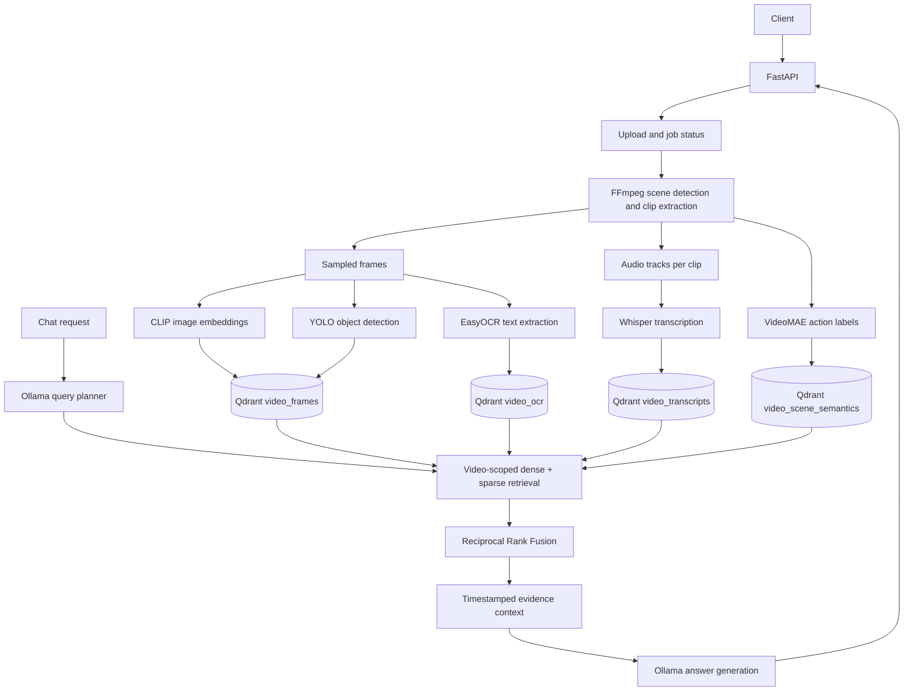

# Multimodal Video Search & Agentic Retrieval Engine

A video-understanding backend that indexes **what appears, what is written, what is spoken, and what actions occur** in a video. Ask natural-language questions and receive answers grounded in retrieved evidence with timestamps.

The service is built with FastAPI, FFmpeg, CLIP, YOLO, EasyOCR, Faster-Whisper, Sentence Transformers, VideoMAE, Qdrant, and Ollama.

> **Project status:** The repository now includes a consistent ingestion/retrieval/chat implementation, environment-based configuration, tests for core logic, and a Docker setup. The complete GPU/model pipeline still needs to be exercised on a machine with FFmpeg, Qdrant, model access, and (optionally) CUDA. The automated unit tests do not prove that every third-party model downloads or runs on every hardware configuration.

---

## Contents

- [What it does](#what-it-does)
- [Architecture](#architecture)
- [How a video is processed](#how-a-video-is-processed)
- [How search and chat work](#how-search-and-chat-work)
- [Models and vector collections](#models-and-vector-collections)
- [Repository structure](#repository-structure)
- [Requirements](#requirements)
- [Run locally](#run-locally)
- [Run with Docker Compose](#run-with-docker-compose)
- [API reference](#api-reference)
- [Configuration](#configuration)
- [Tests](#tests)
- [Operational notes and limitations](#operational-notes-and-limitations)

## What it does

1. Accepts an uploaded video and assigns it a unique `video_id`.
2. Detects scene changes and splits long scenes into manageable clips.
3. Samples frames and extracts visual, object, and OCR features.
4. Transcribes speech and creates semantic embeddings.
5. Optionally predicts action labels for each clip.
6. Stores dense and sparse vectors in separate Qdrant collections.
7. Plans a natural-language search query with a local Ollama model (with a fallback if Ollama is unavailable).
8. Retrieves evidence only from the requested video, combines ranked results with Reciprocal Rank Fusion (RRF), and asks Ollama to produce a timestamp-grounded answer.

## Architecture



## How a video is processed

### 1. Upload and workspace creation

`POST /ingest` accepts an MP4, AVI, MOV, MKV, or WebM file. The server streams it to a UUID-named file under `storage/raw/`, enforces `MAX_UPLOAD_BYTES`, then schedules a background ingestion task.

Each video gets a workspace:

```text
storage/
├── raw/                         # temporary upload; deleted after processing
└── processed/
    └── <video_id>/
        ├── chunks/              # timestamped scene clips
        ├── frames/              # sampled JPEG frames
        └── audio/
            └── transcripts/
                └── transcript.json
```

### 2. Scene detection and chunking

`core/ingestion.py` uses FFmpeg's scene-selection filter to identify scene boundaries. It parses only frames selected by the scene filter (rather than treating every frame's metadata as a scene boundary), then subdivides long scenes so no clip exceeds `MAX_VIDEO_CHUNK_SECONDS`.

Each clip is written as:

`scene_<start>_to_<end>.mp4`

FFmpeg samples frames at 0.5 FPS. The sampled frame index is converted back to an approximate absolute video timestamp during indexing.

### 3. Visual analysis

For each sampled frame:

- **CLIP** creates a normalized 512-dimensional image vector.
- **YOLOv10** detects objects and stores their labels, confidence values, and bounding boxes.
- **EasyOCR** extracts visible text. OCR text is embedded with the same 384-dimensional Sentence Transformer used for speech.

Visual and OCR records are stored separately so text found inside a frame can be searched independently from its image representation.

### 4. Speech and action analysis

Each scene clip is passed to FFmpeg to extract 16 kHz mono audio. Faster-Whisper transcribes the clip; Sentence Transformers creates a 384-dimensional embedding for the transcript.

When action recognition is enabled, VideoMAE samples 16 frames from the clip and predicts its top action labels. If VideoMAE cannot initialize, the API logs the issue and continues without action indexing.

### 5. Dense and sparse indexing

Every searchable record has a dense semantic vector and a BM25 sparse vector. Payloads include the video ID and timestamps so retrieval can filter to one video and reconstruct a local timeline.

## How search and chat work

1. The optional **agent planner** asks Ollama to rewrite the user's message as a concise search query and select relevant channels (frames, transcripts, OCR, and/or actions). If Ollama is unavailable, the original message is used and all channels remain eligible.
2. The retriever searches only the selected channels and creates the required CLIP text, Sentence Transformer, and BM25 query vectors.
3. Each Qdrant collection is searched independently with a mandatory `video_id` filter.
4. Dense and sparse rankings are fused per collection, then the channel rankings are fused with RRF.
5. The engine loads nearby transcript, OCR, visual, and action evidence from Qdrant.
6. Ollama receives the evidence and must answer from that evidence, citing timestamps. If retrieval returns no evidence, the engine does **not** ask the LLM to guess.

The chat engine keeps a small in-memory session state to maintain a current timestamp for follow-up questions. Session history can also be supplied by the client.

## Models and vector collections

| Component | Model / implementation | Purpose | Vector size |
|---|---|---|---:|
| Visual encoder | `openai/clip-vit-base-patch32` | Image and text-to-image retrieval | 512 |
| Object detector | `yolov10n.pt` via Ultralytics YOLO | Object labels and bounding boxes | Sparse BM25 |
| OCR | EasyOCR (`en`) | Text visible in frames | 384 + sparse |
| Speech | Faster-Whisper (`base` by default) | Speech transcription | — |
| Text encoder | `sentence-transformers/all-MiniLM-L6-v2` | Transcript, OCR, action semantics | 384 |
| Action classifier | `MCG-NJU/videomae-base-finetuned-kinetics` | Clip-level action labels | 384 + sparse |
| Sparse encoder | `Qdrant/bm25` via FastEmbed | Lexical matching | Sparse |

Qdrant collections:

| Collection | Dense vector name | Payload highlights |
|---|---|---|
| `video_frames` | `clip` (512) | `video_id`, `timestamp`, `detected_objects`, `ocr_text`, detections |
| `video_transcripts` | `dense` (384) | `video_id`, `start_time`, `end_time`, transcript `text` |
| `video_ocr` | `dense` (384) | `video_id`, `timestamp`, OCR `text` |
| `video_scene_semantics` | `dense` (384) | `video_id`, `start_time`, `end_time`, `semantic_text` |

All four collections also have a named `bm25` sparse vector.

## Repository structure

| Path | Responsibility |
|---|---|
| `main.py` | FastAPI application, lifespan/model initialization, upload endpoint, background ingestion, Qdrant writes, ingestion status, chat/session endpoints |
| `config/config.py` | Environment-backed settings; keeps configuration centralized |
| `core/ingestion.py` | FFmpeg duration probing, scene-boundary detection, bounded clip creation, frame sampling, workspace management |
| `core/embedder.py` | CLIP image preprocessing and normalized frame embeddings |
| `core/detector.py` | YOLO object detection and normalized detection output |
| `core/ocr.py` | EasyOCR wrapper with CPU/GPU selection |
| `core/audio_processor.py` | Per-clip audio extraction, Faster-Whisper transcription, Sentence Transformer embeddings |
| `core/scene.py` | VideoMAE frame sampling and action-label inference |
| `core/vector_db.py` | Qdrant connection, collection/index creation, batched upserts |
| `core/retriever.py` | Video-filtered dense/sparse search, RRF fusion, temporal context lookup |
| `core/agent.py` | Optional Ollama query planner and safe fallback to the original query |
| `core/chat_engine.py` | Evidence-grounded chat, timestamp context, safe no-evidence response, session continuity |
| `tests/` | Unit tests for retrieval fusion, chat evidence handling, and ingestion workspace creation |
| `requirements.txt` | Python runtime dependencies |
| `.env.example` | Documented environment-variable defaults |
| `Dockerfile` | Reproducible Python/FFmpeg API image |
| `docker-compose.yml` | API, Qdrant, and Ollama services |
| `.dockerignore` / `.gitignore` | Excludes runtime data, model weights, caches, and local secrets |

The previous unused alternate LangGraph chat implementation was removed so there is one active chat path. The downloaded YOLO checkpoint and committed Python bytecode caches were also removed from version control; Ultralytics can obtain the configured checkpoint when first needed.

## Requirements

- Python 3.11 recommended.
- FFmpeg and FFprobe available on `PATH`.
- Qdrant (local Docker or remote instance).
- Ollama with the configured chat model pulled.
- Internet access on first startup to download model weights/tokenizers.
- Enough RAM/VRAM for the selected models. CPU fallback is supported, but model loading and video processing can be slow.
- CUDA is optional. Set `MODEL_DEVICE=auto` to select CUDA when available, otherwise CPU.

## Run locally

### 1. Install system tools

Install FFmpeg (including FFprobe) using your operating system's package manager and verify:

```bash
ffmpeg -version
ffprobe -version
```

### 2. Create an environment and install Python dependencies

```bash
python3.11 -m venv .venv
# Linux/macOS
source .venv/bin/activate
# Windows PowerShell
# .venv\Scripts\Activate.ps1

python -m pip install --upgrade pip
pip install -r requirements.txt
```

For NVIDIA acceleration, install a PyTorch build compatible with your installed CUDA runtime before installing the remaining dependencies. Consult the official PyTorch installation selector for the exact command for your platform.

### 3. Configure services

```bash
cp .env.example .env
```

Start Qdrant:

```bash
docker run -d --name video-engine-qdrant \
  -p 6333:6333 -p 6334:6334 \
  -v qdrant_data:/qdrant/storage \
  qdrant/qdrant:v1.13.2
```

Install and start Ollama, then pull the configured model:

```bash
ollama pull llama3
ollama serve
```

### 4. Start the API

```bash
python main.py
```

Open the interactive API documentation at [http://localhost:8000/docs](http://localhost:8000/docs). The API listens on `0.0.0.0:8000` by default.

## Run with Docker Compose

```bash
cp .env.example .env
docker compose up --build -d
docker compose logs -f api
```

Pull the Ollama model once the Ollama service is running:

```bash
docker compose exec ollama ollama pull llama3
```

Then open [http://localhost:8000/docs](http://localhost:8000/docs).

The first API startup downloads several large model checkpoints and may take a while. To reduce memory usage, set `ENABLE_SCENE_RECOGNITION=false` in `.env` before starting the stack. The Docker image uses CPU-oriented defaults; GPU-enabled containers require a host NVIDIA driver, NVIDIA Container Toolkit, and a CUDA-compatible PyTorch/runtime setup.

## API reference

### `GET /health`

Simple process health check.

Example response:

```json
{"status":"ok","service":"multimodal-video-search"}
```

### `POST /ingest`

Multipart form upload with a field named `file`.

```bash
curl -X POST http://localhost:8000/ingest \
  -F "file=@./sample-video.mp4"
```

Example response:

```json
{
  "status": "queued",
  "video_id": "generated-uuid",
  "status_url": "/ingest/generated-uuid"
}
```

### `GET /ingest/{video_id}`

Poll ingestion state. Possible values are `queued`, `processing`, `completed`, and `failed`. Completed responses include counts for frames, OCR records, transcript chunks, and action records. Job status is in memory and is lost if the API process restarts.

### `POST /api/v1/chat`

Request:

```json
{
  "video_id": "generated-uuid",
  "message": "What does the person pick up?",
  "session_id": "client-generated-or-server-default",
  "history": []
}
```

`session_id` is optional; the server generates one when omitted. Reuse the same ID for turns in the same conversation. Supply recent history as `[{ "role": "user", "content": "..." }, { "role": "assistant", "content": "..." }]`.

The response contains `response`, `session_id`, `needs_user_input`, `options`, `query_plan`, and a compact `session_state`.

### `DELETE /api/v1/chat/session/{session_id}`

Clear in-memory session state when the conversation ends.

## Configuration

Copy `.env.example` to `.env`. Main settings:

| Variable | Default | Description |
|---|---|---|
| `APP_HOST` | `0.0.0.0` | API bind address |
| `APP_PORT` | `8000` | API port |
| `STORAGE_DIR` | `./storage` | Upload and processed-video workspace |
| `QDRANT_URL` | `http://localhost:6333` | Qdrant endpoint |
| `OLLAMA_URL` | `http://localhost:11434` | Ollama base URL |
| `OLLAMA_MODEL` | `llama3` | Chat/planner model |
| `WHISPER_MODEL` | `base` | Faster-Whisper checkpoint |
| `MODEL_DEVICE` | `auto` | `auto`, `cpu`, or CUDA device |
| `ENABLE_SCENE_RECOGNITION` | `true` | Enable VideoMAE action labels |
| `MAX_UPLOAD_BYTES` | `2147483648` | Maximum upload size (2 GiB) |
| `MAX_VIDEO_CHUNK_SECONDS` | `30` | Maximum scene clip duration |
| `RETRIEVAL_LIMIT` | `5` | Number of fused retrieval results |

In Docker Compose, the API connects to the service names `qdrant` and `ollama`; locally, the defaults use `localhost`.

## Tests

Run the unit tests from the repository root:

```bash
python -m unittest discover -s tests -v
```

The tests cover RRF grouping (including the second fusion stage), video-scoped chat retrieval/evidence fallback, refusal to call the LLM when there is no evidence, and ingestion workspace creation. They do not download models, launch Qdrant/Ollama, process real media, or replace an end-to-end smoke test.

## Operational notes and limitations

- **Model startup is intentionally explicit.** The FastAPI lifespan loads models once. If a large model cannot load, startup may fail; action recognition alone is optional and degrades gracefully.
- **CPU is supported but slower.** CLIP, OCR, Whisper, YOLO, and VideoMAE can consume substantial RAM and CPU time.
- **Ollama is a runtime dependency for generated answers.** If it is unavailable, query planning falls back to the raw user query and chat returns a clear model-unavailable message after evidence retrieval.
- **Job/session state is in memory.** The current FastAPI background-task and session dictionaries are suitable for a single-process demo, not durable production workloads. Use a task queue and persistent session/job store before scaling to multiple workers or replicas.
- **No authentication is included.** Do not expose this API directly to the public internet without authentication, authorization, rate limiting, and upload scanning.
- **Qdrant must retain its volume.** Deleting the Qdrant volume deletes the indexed vectors.
- **First-run downloads are large.** Cache model files on persistent storage and plan for several GB of disk space.
- **No real-video end-to-end run is claimed by the unit tests.** Verify the full workflow with representative videos and your target hardware before production use.

## License

No license file is currently included. Add a license before redistributing or accepting external contributions under explicit terms.
